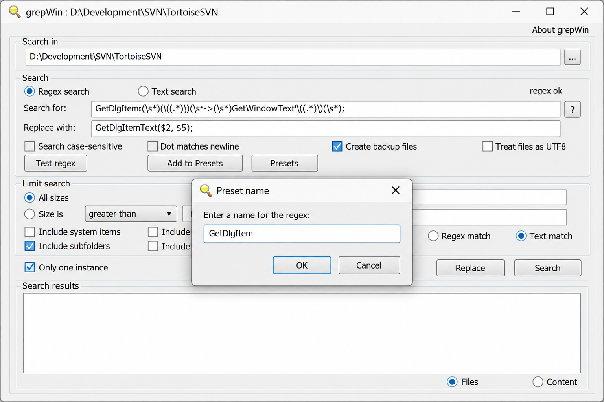
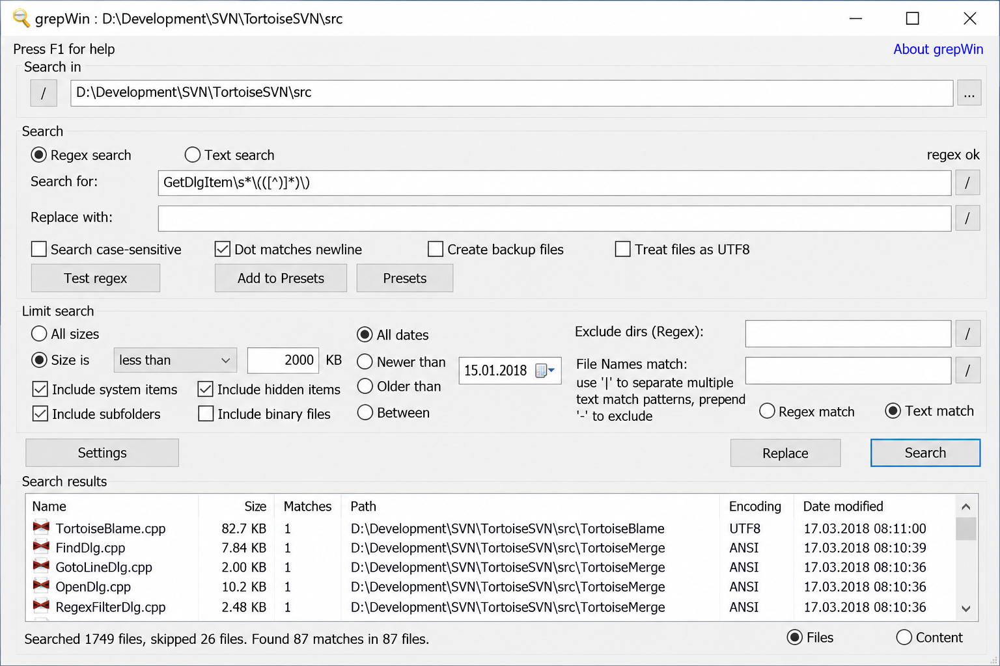
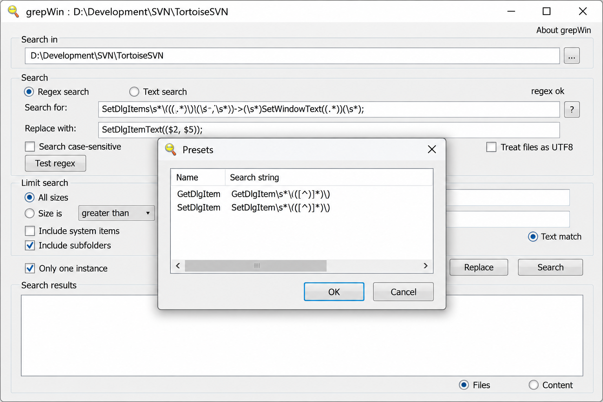

# GrepWin Regex Search - Fast Windows Regular Expression Search And Replace

GrepWin Search Replace maintains GrepWin Regex Search, a Windows desktop application for finding and replacing text across files and folders. GrepWin Regex Search combines regular expressions, previews, file filters, capture groups, backups, and Windows Explorer integration in one focused interface.

GrepWin Search Replace is designed for repeatable bulk editing without requiring a command-line workflow. The central implementation is available in [src/grepWin.cpp](src/grepWin.cpp), while the primary search interface is implemented in [src/SearchDlg.cpp](src/SearchDlg.cpp).

# Command Line Parameters

GrepWin Regex Search supports command-line parameters for launching searches from selected paths. The application also integrates with Windows Explorer, allowing a directory to be passed directly into the GrepWin Search Replace workflow.

The graphical interface remains the primary way to configure a search:

1. Select the target folder.
2. Enter text or a regular expression.
3. Configure replacement text when required.
4. Apply file type, size, date, hidden-file, or system-file filters.
5. Run the search and inspect matching files.
6. Enable backups or timestamp preservation before replacing content.

# Why Use GrepWin Regex Search?

- **Focused Windows workflow.** GrepWin Search Replace provides a native desktop interface instead of requiring shell commands.
- **Regular expression support.** GrepWin Regex Search handles literal text, regular expressions, capture groups, and formatted replacements.
- **Search previews.** Matching files, lines, and line numbers can be inspected before changes are applied.
- **File selection controls.** GrepWin Search Replace can narrow work by filename, file type, date, size, and file attributes.
- **Safer replacement.** Backup and timestamp options reduce the risk associated with bulk replacement.
- **Explorer integration.** GrepWin Regex Search can begin from the Windows Explorer context menu.
- **Localized interface.** GrepWin Search Replace includes multiple maintained interface translations.

# Overview

GrepWin Search Replace organizes folder selection, matching, replacement, filtering, and result inspection in a single window. GrepWin Regex Search is intended for text files, source trees, configuration collections, documentation, and other directory-based content.

| Area | GrepWin Regex Search Behavior |
| --- | --- |
| Search mode | Literal text or regular expressions |
| Scope | One folder and its selected files |
| Results | Matching files, lines, and line numbers |
| Replacement | Plain text, capture groups, and supported variables |
| Filters | File patterns, size, date, and attributes |
| Safety | Optional backups and preserved timestamps |
| Integration | Windows Explorer context menu |
| Platform | Windows desktop |

## Regular Expressions

GrepWin Regex Search uses regular expressions for advanced text matching. The built-in regex test dialog is implemented in [src/RegexTestDlg.cpp](src/RegexTestDlg.cpp), and replacement formatting is handled by [src/RegexReplaceFormatter.cpp](src/RegexReplaceFormatter.cpp).

Capture groups can reuse matched content in replacement text. GrepWin replace capture groups supports numbered values such as `$1` through `$9`. GrepWin Search Replace can also use supported file variables such as `${filepath}` and `${filename}` when constructing replacement output.

Use literal matching when the target text has no structural variation. Use GrepWin regex find and replace when the match depends on boundaries, repetition, alternatives, groups, or variable text.

> [!IMPORTANT]
> Review matches before applying a replacement across many files. A valid regular expression can still match more content than intended.

## File Selection

GrepWin search filename controls and GrepWin file type filters restrict the files included in a run. File patterns such as `*.txt`, `*.md`, or other required extensions can reduce unnecessary scanning and prevent unrelated files from being modified.

GrepWin regex search paths begins with the selected folder. Search settings and persisted preferences are implemented in [src/Settings.cpp](src/Settings.cpp), while search state is represented by [src/SearchInfo.cpp](src/SearchInfo.cpp).

## Search And Replacement

GrepWin search file contents displays matching text in context. Double-clicking a result allows the matching file and location to be inspected before replacement.

GrepWin search and replace multiple files is the primary bulk-editing workflow. GrepWin Search Replace separates searching from replacement so users can validate the result set first. Newline-specific editing is supported by [src/NewlinesDlg.cpp](src/NewlinesDlg.cpp), and multiline input is handled by [src/MultiLineEditDlg.cpp](src/MultiLineEditDlg.cpp).

## Windows Explorer Integration

The GrepWin Windows Explorer context menu provides direct access from a selected directory. The classic shell integration is implemented in [src/ShellContextMenu.cpp](src/ShellContextMenu.cpp). The newer Explorer command component is defined by [src/ExplorerCommandVerb/ExplorerCommandVerb.vcxproj](src/ExplorerCommandVerb/ExplorerCommandVerb.vcxproj).

The application manifests include [src/compatibility.manifest](src/compatibility.manifest) and [src/ExplorerCommandVerb/compatibility.manifest](src/ExplorerCommandVerb/compatibility.manifest).

### Search Vocabulary

grepwin search replace, grepwin regex search, grepwin text search, grepwin search filename, grepwin search replace utility, search-and-replace, regex, regular-expressions, file-search, bulk-replace, text-processing, windows, desktop-application

# How To Install

## Windows

GrepWin Search Replace is a Windows desktop application. GrepWin search replace Windows 11 uses the same folder-selection, search, preview, and replacement workflow.

The installer definition is maintained in [src/Setup/Setup.wxs](src/Setup/Setup.wxs). Windows package metadata is available in [choco/grepwin.nuspec](choco/grepwin.nuspec), and the application package manifest is generated from [src/Setup/AppXManifest.xml.in](src/Setup/AppXManifest.xml.in).

# Building From Source

GrepWin Regex Search is a C++ Windows application built with Microsoft Visual Studio and MSBuild.

1. Open [grepWin.slnx](grepWin.slnx) in a compatible Visual Studio installation.
2. Restore the dependencies declared by [vcpkg.json](vcpkg.json) and [src/packages.config](src/packages.config).
3. Select the required Windows platform and build configuration.
4. Build the solution.
5. Review generated version information from [version.txt](version.txt) and [versioninfo.build](versioninfo.build).

The main Visual Studio project is [src/grepWin.vcxproj](src/grepWin.vcxproj). Automated Windows builds are defined in [.github/workflows/msbuild.yml](.github/workflows/msbuild.yml), while release and package automation are maintained in [.github/workflows/release.yml](.github/workflows/release.yml) and [.github/workflows/winget.yml](.github/workflows/winget.yml).

# Development

GrepWin Search Replace separates the desktop interface, search configuration, replacement formatting, bookmarks, themes, setup actions, and shell integration into focused C++ components.

- [src/SearchDlg.cpp](src/SearchDlg.cpp) implements the primary GrepWin text search interface.
- [src/RegexTestDlg.cpp](src/RegexTestDlg.cpp) provides regular expression testing.
- [src/RegexReplaceFormatter.cpp](src/RegexReplaceFormatter.cpp) formats replacement output.
- [src/Bookmarks.cpp](src/Bookmarks.cpp) manages saved locations.
- [src/Theme.cpp](src/Theme.cpp) handles interface themes.
- [src/Setup/CustomActions/CustomActions.cpp](src/Setup/CustomActions/CustomActions.cpp) provides installer custom actions.
- [src/Resources/grepWin.rc](src/Resources/grepWin.rc) defines Windows resources.

Formatting conventions are recorded in [.clang-format](.clang-format) and [.editorconfig](.editorconfig). Release changes are documented in [CHANGELOG.md](CHANGELOG.md).

# Translations

GrepWin Regex Search includes localized interface resources for English, British English, Chinese, Dutch, French, German, Italian, Japanese, Korean, Polish, Portuguese, Brazilian Portuguese, Russian, and Spanish.

The default language resources are available in [translations/English.lang](translations/English.lang). Each translation follows the same application resource model used by GrepWin Search Replace.

# Contributing

Contributions to GrepWin Search Replace should preserve the Windows interface, regular expression behavior, replacement semantics, file safety options, and Explorer integration.

Read [CONTRIBUTING.md](CONTRIBUTING.md) before proposing changes. Feature requests and bug reports use the templates in [.github/ISSUE_TEMPLATE/1-feature-request.yml](.github/ISSUE_TEMPLATE/1-feature-request.yml) and [.github/ISSUE_TEMPLATE/2-bug-report.yml](.github/ISSUE_TEMPLATE/2-bug-report.yml).

# License

GrepWin Search Replace and GrepWin Regex Search are distributed under the terms provided in [LICENSE](LICENSE).
